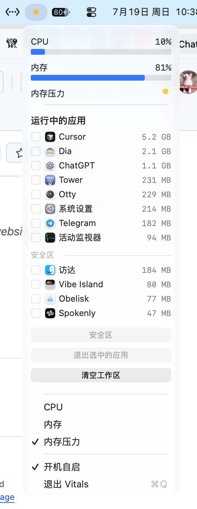

<p align="center">
  
</p>

<h1 align="center">Vitals</h1>

<p align="center">
  一个住在 macOS 菜单栏里的轻量系统监控。<br>
  CPU、内存、内存压力、窗口快捷键，以及长按清空工作区。
</p>


<p align="center">
  <a href="https://github.com/imeelinew/Vitals/releases">下载</a> ·
  <a href="#安装">安装</a> ·
  <a href="#从源码构建">从源码构建</a>
</p>

<p align="center">
  <a href="README.md">简体中文</a>
  <a href="README.en.md">English</a>
</p>

<p align="center">
  <a href="https://github.com/imeelinew/Vitals/releases/latest"></a>
  
  
  <a href="LICENSE"></a>
</p>

---

<p align="center">
  
</p>

## 简介

Vitals 是一个常驻菜单栏的 macOS 系统监控工具，适合那些想随时看见 CPU、内存和内存压力，又希望快速关掉占内存应用、腾出工作区的人。

它刻意保持很轻：用原生 AppKit 自绘菜单界面，避免拉入 SwiftUI 一类重依赖，目标是把自身物理 footprint 压在很低的水平，好让监控工具本身不成为负担。

## 为什么开发 Vitals

活动监视器很完整，但对「看一眼资源、关掉几个占地方的 App」来说往往太重。Vitals 把最常用的几件事收进菜单栏：状态一眼可见，应用按内存排序，安全区里的应用不会被一键清掉。

- **菜单栏优先**：菜单栏只显示仪表图标，展开后在面板顶部查看 CPU、内存占用和内存压力。
- **按内存排序的应用列表**：带图标查看当前运行中的常规应用及其占用，Finder 不显示在列表中。
- **安全区**：保护应用及其窗口，清空工作区时保持不动。
- **清空工作区**：长按确认后请求未保护的应用正常退出，并关闭 Finder 窗口；应用可以提示保存或取消退出。
- **窗口管理**：内置原 Window 的全部快捷键、平滑移动与缩放，以及 Dock / 显示器变化后的最大化跟踪。
- **轻量常驻**：为长时间挂在菜单栏而设计，采样与界面都按低 footprint 约束实现。

## 菜单栏

打开菜单即可看到 CPU、内存进度条和内存压力指示，以及当前运行中的应用列表。你可以勾选后退出选中应用，也可以长按清空工作区；安全区里的应用会单独列出，不会被批量操作误伤。

## 其他功能

- 开机自启
- 退出选中应用时关闭其全部窗口
- 应用图标与占用一并展示，方便快速识别
- 菜单关闭后销毁面板视图，避免常驻占内存

## 窗口管理

窗口管理随 Vitals 在后台启动，菜单、面板和图标保持不变。首次启动通过系统标准流程请求辅助功能权限，请在「系统设置 → 隐私与安全性 → 辅助功能」中允许 Vitals。原 Window 的授权不会转移给 Vitals。

| 快捷键 | 操作 |
| --- | --- |
| `Command + ↑` | 最大化到当前屏幕可用区域 |
| `Command + ← / →` | 左半屏 / 右半屏 |
| `Command + ↓` | 调整为 998 × 836，并居中 |
| `Option + Command + ← / →` | 按住连续减小 / 增大宽度，中心不动 |
| `Option + Command + ↑ / ↓` | 按住连续增大 / 减小高度，中心不动 |
| `Control + Option + 方向键` | 按住向对应方向平滑移动，尺寸不变 |

移动和缩放以约 500 点/秒、60 fps 为目标，松开即停，空闲时没有动画任务。操作适配多显示器，并避开菜单栏和 Dock；最大化窗口会在工作区变化后重新贴合，手动调整后停止跟踪。全屏、最小化或不支持对应操作的窗口会被忽略。

从 Window 迁移时，请退出独立的 Window，并移除它的登录项，避免重复注册快捷键。更新与开机自启统一由 Vitals 管理；退出 Vitals 也会停止窗口管理。

## 安装

从 [Releases 页面](https://github.com/imeelinew/Vitals/releases)下载最新版，解压后将 `Vitals.app` 拖入「应用程序」文件夹。需要 macOS 26 或更高版本。

## 从源码构建

```sh
xcodebuild -project Vitals.xcodeproj -scheme Vitals -configuration Release build
```

构建产物在 Xcode DerivedData 的 `Build/Products/Release/Vitals.app`。Release 配置开启死代码剥离与 strip，便于验证 footprint。

运行窗口几何和按键连续调整回归测试：

```sh
./Tests/run.sh
```

构建、签名、安装并重新启动本机版本：

```sh
./scripts/install.sh
```

## 许可

本项目采用 [MIT](LICENSE) 许可证。
